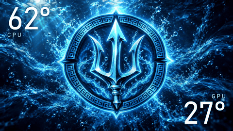

# ThermalWrong



Put your own animations on the Thermalright USB LCD inside your PC, with your live CPU and GPU temperatures drawn on top in clean white text. Loop any video, GIF or image at the screen's native resolution and a steady 30 fps.

> **Built for the Thermalright Dynamic Vision 360 only.** That's the only screen ThermalWrong was designed and tested on. Other Thermalright LCDs may work, but your results may vary (screen size, resolution, orientation, codec and format support, and so on).

> **Unofficial.** ThermalWrong is a fan-made project. It is not affiliated with, endorsed by or supported by Thermalright. "Thermalright" and "TRCC" belong to Thermalright.

## Features

- **Your own media on the screen.** MP4, MOV, MKV, WebM, AVI, GIF, PNG, JPG, BMP and WebP, scaled and cropped to fill the panel and looped forever.
- **Decoded once, played from memory.** Each clip is decoded a single time into ready-to-send frames, so playback is smooth (30 fps, no hitch at the loop point) and light (about 1.5% CPU, around 80 to 110 MB of memory with a 9 second 960x540 clip).
- **Live temperatures, no box.** Big white CPU (top left) and GPU (bottom right) temperatures with only a soft shadow behind them. The numbers come from the same sensor feed and sensor choices as TRCC itself.
- **Plays nicely with TRCC.** One click hands the screen back to TRCC, and another takes it back.
- **Starts with Windows**, with no UAC prompts, and runs quietly in the tray.
- **Comes with a sample:** *Poseidon Underwater*, a 9 second 960x540 loop.

## Requirements

- Windows 10 or 11, 64-bit.
- A **Thermalright Dynamic Vision 360** (USB ID `87AD:70DB`, driven by TRCC's `USBLCDNEW`). Other screens on the same USB ID may work, but results may vary.
- **Thermalright's TRCC installed.** ThermalWrong uses the WinUSB driver, the sensor helper (`HWINFO.exe`) and the `ffmpeg.exe` that come with it. TRCC does not need to be running.

## Install

1. Download `ThermalWrong-Setup-<version>.exe` from [Releases](https://github.com/soybean-alien/ThermalWrong/releases) and run it.
2. Keep **Start ThermalWrong when I sign in** ticked if you want it to replace TRCC at startup. That registers an elevated logon task for ThermalWrong and turns off TRCC's own startup task (it is not deleted).
3. ThermalWrong opens and takes over the screen. Your media lives in `Videos\ThermalWrong`; the Poseidon sample is copied there on first run.

Uninstalling removes the logon task and turns TRCC's startup back on if ThermalWrong had turned it off. Your media and settings (`%APPDATA%\ThermalWrong`) are left alone.

## Using it

| Control | What it does |
|---|---|
| **Media list** | Everything in `Videos\ThermalWrong`. Double-click (or **Show on screen**) to swap what's on the panel. |
| **Add media…** | Copies videos, GIFs or images into the media folder and shows the last one. |
| **On the screen now** | A live preview of what the panel is showing. |
| **Rotation** | *Auto* uses the panel's own default orientation; 0/90/180/270 override it. |
| **Hand screen to TRCC / Take screen from TRCC** | Gives the panel back to TRCC (it starts TRCC) or takes it again (it closes TRCC). |
| **Show temperatures** | Turns the CPU/GPU overlay on or off. |
| **Start with Windows** | Registers or removes the elevated logon task. |

Closing the window keeps ThermalWrong playing from the tray. Right-click the tray icon to switch media, hand the screen over, or exit. Launching ThermalWrong again opens the window.

## How it works

TRCC renders frames and passes them through shared memory to `USBLCDNEW.exe`, which writes them to the LCD over USB. ThermalWrong talks to the LCD directly through `winusb.dll` using the same protocol:

- **Handshake:** a 64-byte packet starting `12 34 56 78` with byte 56 set to `1`. The 1024-byte reply names the panel (`SSCRM-V1`) and its model number (byte 24) and sub-model (byte 36), which select the resolution: 960x540, 1920x462, 1280x480, 480x480 and others.
- **Frames:** a 64-byte header (magic, command `2`, width, height, byte 56 = `2`, JPEG length at offset 60) followed by a JPEG under 450,000 bytes, sent on bulk endpoint `0x01`.
- **Temperatures:** TRCC's `HWINFO.exe` publishes every sensor once a second in the shared memory `shareMemory_SysInfo`. ThermalWrong reads it and picks the CPU sensor (`CPU`, then `CPU Package`, `CPU Die (average)`, `CPU (Tctl/Tdie)`) and the GPU sensor (`GPU Temperature`, then `APU GFX`) in the same order TRCC does.

Only one program can drive the LCD at a time, which is why ThermalWrong closes TRCC to take the screen.

## Supported screens

ThermalWrong was designed for the **Thermalright Dynamic Vision 360** only (960x540, reports `SSCRM-V1`), and that's the only screen it has been tested on. It maps the other resolutions TRCC knows about for this USB device, but those haven't been tried on real hardware, so **your results may vary** with other screens: size, resolution, orientation, codec and format support, and so on. If you try another model, an issue with your panel's model numbers (shown by `ThermalWrong.Cli probe`) is very welcome.

## Build from source

Needs the .NET 8 SDK (and Inno Setup 6.4+ for the installer).

```
dotnet build ThermalWrong.slnx
powershell -File build-installer.ps1      # self-contained publish + installer in artifacts\installer
```

- `src/ThermalWrong.Core`: USB device, protocol, decoder, player, sensors, overlay.
- `src/ThermalWrong.App`: the tray app.
- `src/ThermalWrong.Cli`: diagnostics: `probe`, `test`, `play <file> [--overlay]`, `snapshot`, `frames`, `autostart on|off`.
- `tools/make-icon.ps1` redraws the icon, and `tools/make-demo-gif.ps1` re-records `docs/demo.gif`.

## Credits and AI disclosure
- Made by **soybean_alien**. Licensed under the **MIT License** (see [LICENSE](LICENSE)).
- [SkiaSharp](https://github.com/mono/SkiaSharp) for frame compositing and text, on [.NET 8](https://github.com/dotnet/runtime). The installer is built with [Inno Setup](https://jrsoftware.org/isinfo.php).
- At runtime ThermalWrong uses components that come with TRCC and are not redistributed here: Thermalright's WinUSB driver, the HWiNFO-based sensor helper and ffmpeg. The overlay font, Bahnschrift, ships with Windows.
- Thermalright and TRCC belong to Thermalright. ThermalWrong is an unofficial fan project and isn't affiliated with Thermalright.
- **AI disclosure:** ThermalWrong was designed with and written by **Claude Code (Anthropic, Claude Opus 5.5)**, directed and tested by the author. The *Poseidon Underwater* sample was made by the author with Codex (GPT-sol 6.1) and its built-in image generator, from the author's own Poseidon logo. Tested on real hardware (a Thermalright Dynamic Vision 360, Windows 11, TRCC 2.1.6): playback, the temperature overlay, handing the screen to TRCC and taking it back, the installer (fresh install and upgrade), and starting through the logon task.
